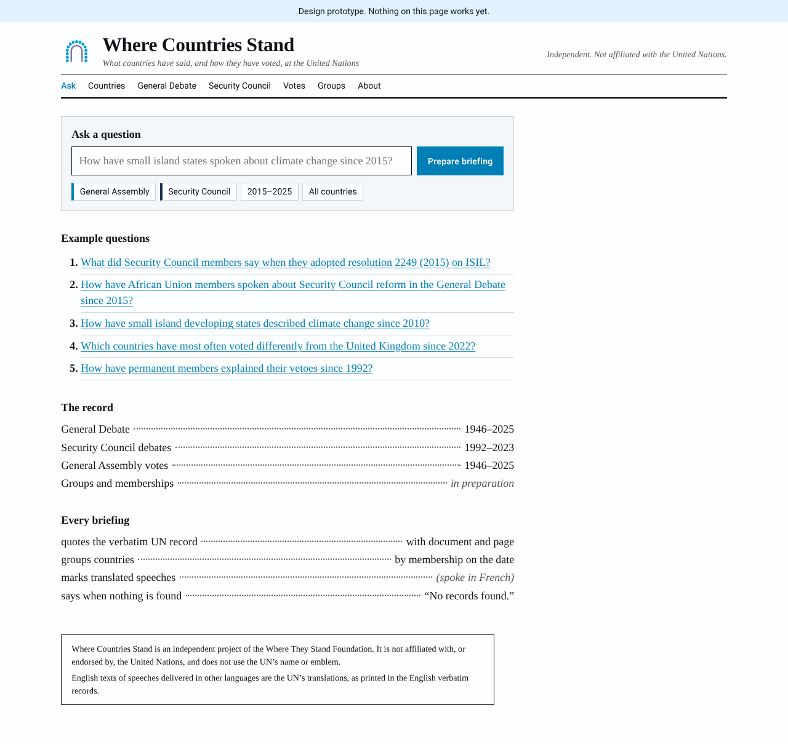

# Design: the look of the UN's Official Records

Where MPs Stand takes its look from Hansard's printed Official Report. Where Countries Stand takes
its look from the UN's printed **Official Records**: the verbatim records of General Assembly and
Security Council meetings (document symbols `A/…/PV.…` and `S/PV.…`). It uses the UN's web palette
and typeface for the controls, and wears the Where They Stand family's binding (below).

The site is in [`web/site/`](../web/site/); its masthead, notice and footer are written once, in
[`web/partials/`](../web/partials/). Screenshots (6 November 2026) are in [`img/`](img/).

## The rule: like the record, never like the UN

The UN's name, its abbreviation and its emblem are reserved for the UN's official purposes under
General Assembly resolution 92(I) (1946), and protected internationally under Article 6ter of the
Paris Convention. Using them needs the Secretary-General's authorisation. So:

- **No UN emblem**, and nothing that resembles it. That means no world map seen from above the
  North Pole, and no olive branches.
- **No "United Nations" or "UN" wordmark or logo**, and neither in the site's name or domain. The
  words appear only in ordinary sentences ("…at the United Nations").
- **No UN-style document symbols for our own pages.** UN symbols (`S/PV.7565`) appear only as
  citations of real UN documents. Our briefings carry no reference numbers that could pass for
  UN ones.
- **Independence is stated on every page**: in the masthead ("Independent. Not affiliated with the
  United Nations.") and in the notice box at the foot ("Where Countries Stand is independent. It is not
  affiliated with or endorsed by the United Nations, and it does not use the UN's name or emblem.").
- **A screenshot must never pass for a UN document.** The record's typography and conventions are
  borrowed, but the masthead is our own name and mark.

This matches Where MPs Stand, which takes Hansard's look but doesn't use Parliament's logo or the
crowned portcullis.

## What is borrowed from the record

Based on S/PV.7565 (20 November 2015):

| In the record | In the site |
|---|---|
| Set in **Times New Roman**, two justified columns | Body in **Tinos**, which is metrically identical to Times New Roman (Apache 2.0). Everything is a **single column**, ragged right, at a comfortable reading width (about 46rem). The record's two columns are not copied. |
| Masthead: body name large and bold, session line in italic beneath, status ("Provisional") in italic on the right | Site name large and bold, a description in italic beneath, "Independent. Not affiliated with the United Nations." in italic on the right |
| Running header between rules: symbol · agenda item in italic · date | "Briefing" · topic in italic · date |
| Speakers as **Mr. Delattre** (France) *(spoke in French)*: | Exactly the same in every source. The italic language note doubles as the translation flag. |
| Procedural lines in italics: *A vote was taken by show of hands.* | The same, for procedural notes and vote labels (*In favour:*) |
| List of members with dotted leaders: *President:* Mr. Rycroft …… (United Kingdom) | The lists of coverage on the home page |
| Agenda items as a numbered list | Example questions numbered the same way |
| Boxed notice at the foot of the first page | Boxed notice at the foot of every page: independence, and that translated speeches are the UN's translations |

## Colour and type

| Token | Use | Value |
|---|---|---|
| UN Blue | Links, focus rings, primary buttons, the **General Assembly** | `#009EDB` (Pantone 2925), from the UN's 2020 brand quick guide; darkened in the stylesheet to `oklch(0.54 0.13 237)` (about `#0078B0`) so that text and buttons meet the contrast guidelines |
| Council navy | The **Security Council** | Deep navy, `oklch(0.31 0.06 262)` |
| Ink and paper | Text and background | Near-black on white. The records are printed on white, unlike Hansard's ivory. |
| Record blue | The family binding only: the spine and `theme-color` | `#1F5F8B`, the site's cloth in the family (decision 3 of the family plan). Never used for content |

- **The body determines the colour,** the way Where MPs Stand uses green for the Commons and red
  for the Lords. Sources and filter chips are edged in UN Blue for the General Assembly and Council
  navy for the Security Council. Further bodies (the Human Rights Council, for example) get their
  own colour from the same family.
- **Votes use neutral marks:** filled for yes, outlined for no, hatched for abstain. Never green
  for yes and red for no, which would imply that one way is right.
- **Roboto**, the UN's primary web typeface (Apache 2.0), is used for controls only: navigation,
  buttons, chips, metadata lines and counts. The record is always in Tinos.
- **Source Serif 4**, the family's typeface, sets the headings (`h1`–`h6`) only, as on every family
  site (decision 1 of the family plan). The site's name in the masthead stays in Tinos.
- **Quotation marks and apostrophes are curly** (“ ” ‘ ’), as the record prints them. The model writes straight
  ones, which are curled once a briefing has been checked (`wcs.rag.typography`); those inside a web address,
  `code` or an HTML tag are left as they are.
- All three fonts are bundled with the site, not loaded from Google: Tinos and Roboto in
  `web/site/fonts/`, Source Serif 4 in the family kit's `web/site/family/fonts/`.

## The mark

Fifteen seats around a horseshoe table, open towards the viewer (`web/site/icon.svg`). It
suggests where countries sit and stand, and the fifteen seats are the Security Council's. It looks
nothing like the UN emblem. It is the page mark, beside the name in the masthead, and since the family kit 1.1.0
also the favicon and the link card (decision 4 of the family plan, amended at the owner's request on 6 November
2026). The favicon puts it on a white tile, as it sits on the white page, so it stays clear on a dark browser tab; at
16 and 32 px, and in the SVG favicon, it has eleven larger seats. The family's spine stays in the endorsement and the
footer shelf.

## Place in the family

Where Countries Stand is a Where They Stand project, on the International shelf with Where Lives Stand.
Every family site carries the same binding, from the family kit (`web/site/family/`, copied in by the
kit's `sync.mjs`; don't edit the copies):

- **The endorsement** under the site's name: the spine in Record blue and "A Where They Stand project",
  linking to wheretheystand.uk.
- **The footer shelf**: the charity, its status ("Where They Stand is applying to register as a charity
  in England and Wales."), every project's spine and a link to each sister site.
- **The favicon and link card**, the horseshoe (see "The mark"); `theme-color` in Record blue; and Source Serif 4
  for headings.
- **The same furniture, worded the same way**: the phase banner (one sentence, linking to the report
  form), the independence line, and the footer links in the family order (About · Corrections ·
  Accessibility · Privacy · Terms · Press · Status · Source code; the site has no How it works or Data page
  yet). The Press page gives the contact, how to cite a statement, a vote and a briefing, the site in brief and
  the logo files; the Status page reads `/api/status`, and says where it is without JavaScript.

Where the records meet, a briefing links to its sister sites, each link showing that site's spine:
"Ask Where MPs Stand the same question" (`https://wherempsstand.com/?q=…`), and, for each country the
question is about, "Quality of life in … on Where Lives Stand" (`https://wherelivesstand.com/country/<ISO
alpha-3>`).

The About page carries the family's "In the family" paragraph. Print keeps the site's name, the
briefing, its sources with their addresses, and the independence notice.

## Shared with the family

- Square corners, ruled lists, and colour only where it carries meaning.
- OKLCH colour tokens holding both light and dark values, through `light-dark()`. Dark mode follows
  the system setting.
- One fluid type scale, logical properties, visible focus rings, hover styles only for a mouse,
  and animation only when reduced motion isn't requested.
- No horizontal scrolling on phones. Pages are checked at 390 px wide.
- The question box grows with the question, from one line to four (`field-sizing: content`), so a long question,
  and the example in it, shows in full on a phone; Enter asks and Shift+Enter starts a new line. Where a browser
  can't size a box to its text, it is two lines tall (three on the narrowest phones) and can be pulled taller.
